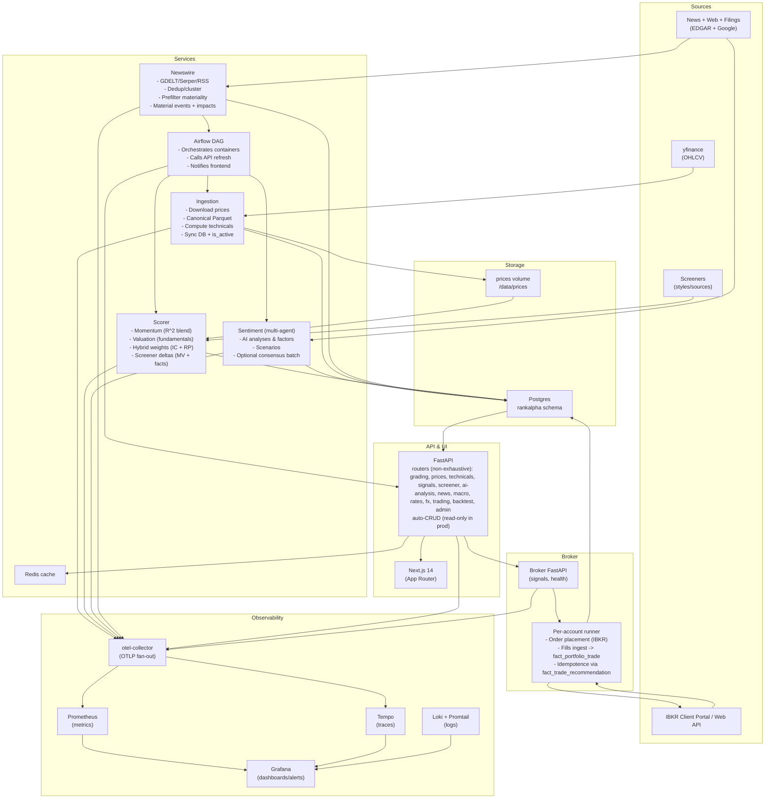

# RankAlpha Architecture (Docker Compose)

The diagram below reflects the current Docker‑Compose stack, services, and data flows.

Rendered image (SVG):





## Regenerating the diagram

The rendered image is generated from `docs/diagrams/architecture.mmd` via Kroki:

```bash
make diagrams
```

This writes fresh renders to `docs/images/architecture.{svg,png}` and copies `docs/images/architecture.svg` to `apps/frontend/public/images/architecture.svg` for the About page.

## Notes

- Ingestion canonicalizes Parquet (`Open, High, Low, Close, Adj Close, Volume`), computes daily technicals, and syncs Adj Close/price history to Postgres.
- Scorer writes momentum/value metrics to `fact_score_history`, computes hybrid weights (IC + RP) into `dim_model_weight` (+ versioned tables), and persists screener deltas.
- Sentiment persists AI analyses/factors and scenarios (primary store: `fact_ai_stock_analysis` and related views like `vw_ai_analysis_latest`); sentiment is optional in the grading composite.
- Newswire collects and de‑dups news (GDELT/Serper/RSS), runs a cheap first‑pass materiality filter, and writes raw/cluster/event/impact tables powering `mv_latest_material_news` and `vw_news_by_symbol`.
- API serves DB-backed reads; Redis wraps GET responses. Airflow triggers refresh endpoints after batch runs and can notify the frontend (`/api/refresh-data`) when enabled.

## Observability & Telemetry

- Application traces and metrics are emitted via OpenTelemetry exporters configured in `apps/common/src/observability.py`.
- The default Docker stack deploys `otel-collector` (OTLP fan-out), `prometheus` (metrics store), `tempo` (trace store), `grafana` (dashboards/alerts), `loki` + `promtail` (centralised logs), and `cadvisor` (container resource telemetry).
- Host-level port collisions between stacks are avoided by overriding telemetry ports (`PROMETHEUS_PORT`, `GRAFANA_PORT`, `INGESTION_METRICS_PORT`, etc.) via per-stack `.compose.env` files.
